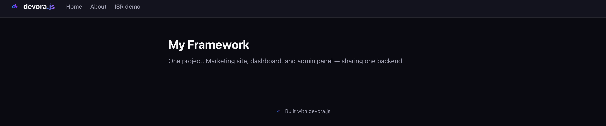
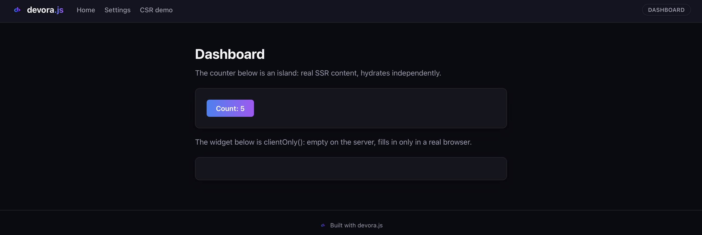
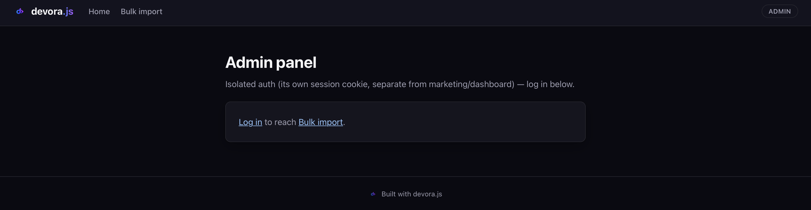

# Devora.js

[](https://github.com/hassanalsa3aka/devora.js/actions/workflows/ci.yml)
[](https://www.npmjs.com/package/@devorajs/core)
[](LICENSE)
[](https://discord.gg/wYFYmFxdS8)

A Vite-based React framework built around one idea : **a project is more than one app.**

Devora.js lets you define several apps in one repo — a marketing site, a product app, an admin
panel — that share a core and a backend, but build and deploy independently. Each app gets its
own render mode, its own auth mode, and its own deploy target, without duplicating the plumbing
between them.

## Why

Most React frameworks assume one app per project. The moment a real product needs a marketing
site, a product app, and an admin panel — a pretty normal shape — you're either cramming them
into one app with route groups, or maintaining separate repos that share nothing. Devora.js
treats "one repo, several independently-deployed apps sharing a core" as the default, not a
workaround bolted on later.

The other design choice: no implicit caching. Every render mode (`ssr`/`ssg`/`csr`/`isr`) is an
explicit, route-level opt-in — no hidden revalidation windows to reverse-engineer, no undocumented
build format standing between you and a plain reverse proxy if you ever need one.

## Live demos

The three example apps from this repo, deployed by the maintainer. Which Devora.js version each
deployment runs isn't stated here; 0.3.2 has not yet been verified on a live Vercel or Netlify
deployment (see `DEPLOYING.md`).

- Vercel: [marketing](https://devora-js-marketing.vercel.app) ·
  [dashboard](https://devora-js-dashboard.vercel.app) ·
  [admin](https://devora-js-admin.vercel.app)
- Netlify: [marketing](https://devorajs.netlify.app) ·
  [dashboard](https://devora-dashboard.netlify.app) ·
  [admin](https://devora-admin.netlify.app)
- Docs site, built with the published npm packages rather than this monorepo:
  [devorajs-docs-docs.vercel.app](https://devorajs-docs-docs.vercel.app)

## Screenshots

The same shared header/theme (`<PageShell>`) across all three apps — one design, not three ad
hoc ones.

**Marketing** (`auth: "none"` — no login anywhere on this app)


**Dashboard** (`auth: "shared"` — an island counter and a `clientOnly()` widget)


**Admin** (`auth: "isolated"` — its own session cookie, separate from the other two)


## Quickstart

```bash
git clone https://github.com/hassanalsa3aka/devora.js.git
cd devora.js
pnpm install
pnpm exec devora dev --app=dashboard
```

Each app gets its own port starting at `10000` (in `devora.config.ts` order), and `devora dev`
prints every app's URL and route table when it boots. To test from a phone on the same Wi-Fi, add
`--host` — it's off by default because it exposes the dev server to everyone on that network.

Or start a brand-new standalone project, outside this repo:

```bash
npm create devora@latest
```

npm and Yarn work too, not just pnpm — see `VERIFICATION.md` for what's actually been tested
under each.

**Requirements:** Node 20 or newer, React 18.3 or 19, Vite 5.4 or 6 (new projects start on
React 18 and whichever Vite the install resolves).

## Key features

- **Multi-app, one repo** — `devora.config.ts` declares each app; `devora build`/`devora deploy`
  handle each one independently.
- **SSR, SSG, CSR, ISR, streaming** — set per route, explicitly. Streaming is GET-only (no
  `action`), and on Netlify it's delivered as one buffered response rather than progressively.
- **Islands** — `island(() => import("./Widget"))` hydrates just that component; the rest of the
  page stays static HTML.
- **Sessions & CSRF built in** — one opaque, server-side, revocable session primitive for both
  browsers (HttpOnly cookie) and API/mobile clients (`Authorization: Bearer`), with CSRF enforced
  only where cookies are involved. Three auth modes per app: `shared`, `isolated`, or `none` (no
  sessions at all, for apps that don't need login, like a marketing site). Shared login across
  subdomains needs `shared.sessions.cookie.domain`; cookie `secure` (`true`/`"auto"`/`false`),
  `sameSite`, `trustProxy` behind a proxy, session lifetimes, `noindex` and `csrf: false` for
  Bearer-only APIs are configurable too. Session storage is bring-your-own — see
  `packages/backend/AUTH.md`.
- **API routes speak JSON, always** — files in the app's `apiDir` folder (`endpoints/` in new
  apps, `api/` by default for older ones) are served under `/api/**`; a thrown error is a
  `{ message }` JSON response with the right status (never an HTML error page), and an unmatched
  `/api/**` path is a JSON 404. `cors` in `app.config.ts` answers cross-origin preflights (off by
  default).
- **Pages that can read the request** — `ctx.url` (query string), `ctx.headers`, `ctx.ip` in
  loaders and actions; actions return data (`fail(400, …)`) or a 303 `redirect()`; thrown errors
  keep their status and render the app's `error.tsx`; multipart uploads (bodies capped by
  `maxBodyBytes`, 10 MB by default); a `<head>` API; route CSS linked automatically. See
  `PAGES.md`.
- **Security headers on by default** — CSP, HSTS, X-Frame-Options, overridable per app.
- **SEO** — OG tags and an auto-generated `sitemap.xml`, opt-in per app.
- **Dynamic routes** — `routes/users/[id].tsx` matches `/users/123`, with the value available as
  `ctx.params.id`. A static route at the same depth always wins over a dynamic one. There are no
  catch-all (`[...slug]`) routes.
- **Backend modules & generic API routes (v2)** — `defineModule()` organizes shared backend logic
  with no DI container, ever; `apiRoute()` handlers live in each app's `apiDir` folder, matched by
  the same file-based router as page routes — a payment-provider webhook finally has somewhere to live
  that isn't a page's `loader`/`action`.
- **Middleware (v2)** — native `withMiddleware()` composition, plus optional
  `fromExpressMiddleware()`/`fromFastifyPlugin()` adapters for the wider npm ecosystem, governed
  from one place per project.
- **Repo-splitting (v2)** — `devora split`/`sync`/`status` convert any app (or the shared backend)
  into a real git submodule with its full commit history preserved, for independent team
  ownership, without giving up the shared-core/shared-backend development model day to day.
- **Deploy targets** — Vercel, Netlify, Docker, or a plain VPS with a generated nginx/Caddy
  config (`devora start`, or `@devorajs/adapter-node` from your own entry point). See
  `DEPLOYING.md`.
- **A CLI that says what it does** — `devora dev` prints every app's URLs, then its routes;
  `--host` exposes dev on your LAN (with a warning), `--routes` lists every API route, `--quiet`
  keeps only warnings, errors and URLs. `devora start` reads `PORT`/`HOST`; `devora build
  --out` relocates Vercel output; `devora add --kind=pages|api` scaffolds a pages app or a
  backend-only API app; `prebuild` in `app.config.ts` runs codegen before a build; `.env` files
  in the project root are loaded automatically.
- **No built-in ORM or auth provider** — bring your own (Prisma, Drizzle, Clerk, Lucia, whatever
  you already use).

What changed in 0.3.2, and what an existing app has to do about it: the 0.3.2 section of
[`CHANGELOG.md`](CHANGELOG.md), which opens with the behavior changes.

## Security hardening (v2)

Once v2's surface (backend modules, API routes, middleware, repo-splitting, streaming) settled, it
went through a real internal audit — every finding below was independently reproduced (a forged
cookie, a crafted `.gitmodules` path, an oversized request body) before being fixed, not assumed
from a description:

- **Cross-app session isolation is cryptographically real**, not just cookie-name-based — the
  app's cookie name (its auth scope) is bound into the HMAC that derives a session's store key, so
  an `"isolated"` app stays isolated from the shared app even if the two share a secret and a store,
  on the cookie *and* the Bearer transport.
- **Request bodies are capped** (10MB default) across every API route and form action.
- **Streaming connections time out** (30s default) instead of holding a connection open
  indefinitely if a Suspense boundary never resolves.
- **Path traversal closed** in the repo-splitting CLI (a crafted `.gitmodules`/`devora.config.ts`
  path could previously run git commands, or delete a directory, outside the project root) and in
  the ISR disk cache (a tainted `getStaticParams()` value could previously write/delete outside its
  own output directory).
- **`devora start`** now sets `NODE_ENV=production` itself, matching `build`/`deploy` — previously
  relying on the caller to have set it.

Not a substitute for a formal third-party audit (still planned once the package has real external
users) — but real, verified hardening in its own right.

## Current limitations

Stated plainly, not buried:

- **No catch-all routes.** `[param]` matches one path segment; `[...slug]` isn't supported.
- **API handlers set headers as a plain object**, so one response can't send several `Set-Cookie`
  headers yet, and responses are buffered (no SSE/WebSockets from an API route).
- **Dynamic routes need `getStaticParams()` for `ssg`/`isr`.** `ssr`/`csr` work on a `[id].tsx`
  route with no extra work; `ssg`/`isr` need a `getStaticParams()` export saying which concrete
  values to pre-render — one static file per entry — and fail the build with a clear error if it's
  missing, rather than silently mis-building.
- **`isr` is weaker on Vercel/Netlify than on a self-hosted `adapter-node` server.** A serverless
  function's filesystem isn't guaranteed to persist between requests, so ongoing background
  regeneration there hasn't been verified (the initial build's output still serves correctly).
- **No DB client, by design.** Framework internals never touch a database — you bring your own
  ORM (architecture-v1.md §6). If you use a driver with native bindings, see
  `packages/backend/DATABASE.md` for a verified pattern that avoids a real crash this framework's
  own dev server can otherwise cause.

## Testing

`pnpm run test` runs 405 Vitest tests in 36 files: `@devorajs/core` units, plus integration tests
that boot real dev and production servers and send real HTTP requests (sessions, cookies, CSRF,
`apiDir`, uploads, error pages), the adapter runtime and CommonJS-banner checks, the preflight
checks, and the terminal formatter. CI also typechecks fresh `create-devora` projects against the
packed packages, smoke-tests the packed `@devorajs/adapter-node`, and builds every app for all
three targets. Docker, the proxy generator against a real nginx/Caddy, and live platform deploys
were checked by hand, not by a test. Full breakdown in `VERIFICATION.md`. If something's broken,
please open an issue.

## Packages

- [`@devorajs/core`](https://www.npmjs.com/package/@devorajs/core) — SSR/streaming request
  handling, sessions/CSRF, security headers, islands, backend modules, API routes, middleware,
  config loading.
- [`@devorajs/cli`](https://www.npmjs.com/package/@devorajs/cli) — the `devora` command, including
  `split`/`sync`/`status` for repo-splitting.
- [`@devorajs/adapter-node`](https://www.npmjs.com/package/@devorajs/adapter-node) — a plain
  Node HTTP server for a production build (what `devora start` runs), for your own entry point.
- [`@devorajs/adapter-vercel`](https://www.npmjs.com/package/@devorajs/adapter-vercel)
- [`@devorajs/adapter-netlify`](https://www.npmjs.com/package/@devorajs/adapter-netlify)
- [`create-devora`](https://www.npmjs.com/package/create-devora) — scaffolds a new standalone
  project (`npm create devora@latest`).

## Docs

- 📖 [Architecture & design spec — v1](architecture-v1.md) — the original vision doc
- 📖 [Architecture & design spec — v2](architecture-v2.md) — backend modules, API routes,
  middleware, repo-splitting, streaming
- 🗺️ [Roadmap](ROADMAP.md) — what's done, in progress, and planned, with the detailed build log
- 🚀 [Deploying](DEPLOYING.md) — Vercel, Netlify, Docker, container platforms, self-hosted VPS, CI
- 📄 [Pages, forms and errors](PAGES.md) — request access, action results, uploads, the head API
- 🔐 [Auth and sessions](packages/backend/AUTH.md) — session stores, cookies behind proxies, CSRF
- ✅ [Testing & verification](VERIFICATION.md)
- 📝 [Changelog](CHANGELOG.md)
- 📚 [Full docs site](https://devorajs-docs-docs.vercel.app) — built with the published packages,
  covers every feature with runnable examples
- 🤝 [Contributing](CONTRIBUTING.md) · 🛡️ [Security policy](SECURITY.md)
- 💬 [Discord](https://discord.gg/wYFYmFxdS8)

## Status

Devora.js is early — pre-1.0, built by one person so far, actively developed. Two products have
been built with it so far ([YallaDo](https://yalla-do-app.vercel.app) and
[Khepra](https://khepra.vercel.app)), and their reviews drove most of 0.3.2. If you try it, I'd
genuinely like to hear what breaks or what's missing — issues, PRs and Discord messages welcome.

## License

MIT
